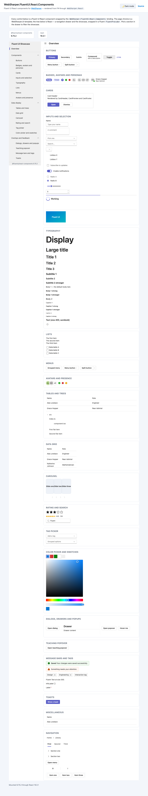

# WebSharper.FluentUI.React.Components

[](https://www.nuget.org/packages/WebSharper.FluentUI.React.Components)

**WebSharper.FluentUI.React.Components** binds [Fluent UI React](https://react.fluentui.dev/) —
Microsoft's design system for React — for [WebSharper](https://websharper.com). Every Fluent UI
component is exposed as a typed F# value that can be composed with the `WebSharper.React`
combinators, with no JSX involved.

The binding targets **`@fluentui/react-components` `>= 9.75.2 < 10.0.0`**, imported from its npm
package and bundled by WebSharper together with your application.

This repository contains:

| Project | Purpose |
| --- | --- |
| `WebSharper.React.FluentUI.Components` | The binding: every component exported by `@fluentui/react-components` plus its context providers (`Components`), the element helpers (`Helpers`), the theming surface (`Styling`, `Themes`), the exported helper functions (`Utilities`) and the shared option/result types (`WebSharper.React.FluentUI.Types`). |
| `WebSharper.React.FluentUI.Components.Sample` | A static SPA that renders a Fluent UI showcase from F#: a WebSharper.UI template as the page chrome, hosting a Fluent `FluentProvider` tree built with the binding. |

## Live demos

**Try it live:** [Open the sample in your browser](https://dotnet-websharper.github.io/fluentui-react-components/)



The sample doubles as the binding's [test case](#running-the-test-case): the page is a WebSharper.UI
template hosting a Fluent UI React app — a **navigation drawer** (a `NavDrawer` with collapsible
`NavCategory` groups, `NavItem`s, `NavSectionHeader`s and a `Hamburger` that collapses the rail) whose
selection filters a showcase of twenty sections. The `FluentProvider` theme follows the light/dark
switcher, and the sections cover buttons, badges/avatars/personas, cards, inputs and selection,
typography, lists, menus, avatars and presence, tables and trees, the data grid, the carousel, rating
and search, the tag picker, the color picker and swatches, dialogs/drawers/popups, the teaching
popover, message bars and tags, toasts, miscellaneous controls and navigation.

- **Sample (this repository):** <https://dotnet-websharper.github.io/fluentui-react-components/>
- **Source repository:** <https://github.com/dotnet-websharper/fluentui-react-components>
- **WebSharper bindings:** <https://websharper.com/bindings>

## Installation

```bash
dotnet add package WebSharper.FluentUI.React.Components
```

or in Paket:

```
nuget WebSharper.FluentUI.React.Components
```

The binding is npm-based: it imports `@fluentui/react-components` at runtime (and `react` /
`react-dom` through `WebSharper.React`), so your application must bundle those npm packages — the
sample does this with esbuild (see `WebSharper.React.FluentUI.Components.Sample/package.json`).

## Usage

Fluent UI components take their props as a `seq<string * obj>`, so ordinary F# tuples are enough.
Combine them with the `Html` combinators from `WebSharper.React` for the plain DOM parts:

```fsharp
namespace MyApp

open WebSharper
open WebSharper.React
open WebSharper.FluentUI.React

[<JavaScript>]
module Demo =

    module F = WebSharper.FluentUI.React.Helpers

    let private prop (k: string) (v: obj) = (k, v)

    let view (dark: bool) =
        F.fluentProvider
            [ prop "theme" (if dark then Themes.teamsDarkTheme else Themes.teamsLightTheme) ]
            [ F.button [ prop "appearance" "primary" ] [ Html.text "Save" ]
              F.badge [ prop "appearance" "tint"; prop "color" "brand"; prop "children" (Html.text "New") ]
              F.field [ prop "label" "Name" ] [ F.input [ prop "placeholder" "Type your name" ] ] ]
```

A few helpers take only the props and render no children (`badge`, `avatar`, `hamburger`, `image`,
`input`, `persona`, `progressBar`, `radio`, `slider`, `spinButton`, `spinner`, `switch`,
`Toast.toaster`) — pass their content through a `"children"` prop.

A navigation rail is a `navDrawer`; it provides the nav context, so the items go straight into its
body:

```fsharp
F.navDrawer
    [ prop "open" true
      prop "type" "inline"
      prop "separator" true
      prop "defaultSelectedValue" "overview"
      prop "defaultOpenCategories" (box [| "components" |]) ]
    [ F.NavDrawer.header [] [ Html.text "Showcase" ]
      F.NavDrawer.body [] [
          F.navItem [ prop "value" "overview" ] [ Html.text "Overview" ]
          F.navDivider [] []
          F.navCategory [ prop "value" "components" ] [
              F.navCategoryItem [] [ Html.text "Components" ]
              F.navSubItemGroup [] [
                  F.navSubItem [ prop "value" "buttons" ] [ Html.text "Buttons" ]
              ]
          ]
      ] ]
```

## Notes on the API

- **Props are string-keyed.** The element helpers (`F.button`, `F.card`, …) take a
  `seq<string * obj>`; the `on.*` and `attr.*` helpers of `WebSharper.React` already produce
  `(string * obj)` values, so they mix freely with Fluent-specific props.
- **Triggers take a single child.** `F.Menu.trigger`, `F.Dialog.trigger`,
  `F.Popover.popoverTrigger` and `F.tooltip` clone their only child, so pass exactly one element
  (for example one `F.button`), not a list of several.
- **`F.overflow` takes one child element** that wraps the `F.overflowItem`s.
- **Navigation.** `F.navDrawer` is the navigation root — it accepts the `Nav` selection and
  category props (`defaultSelectedValue`, `defaultOpenCategories`, `selectedValue`,
  `onNavItemSelect`, …) as well as the `Drawer` props (`open`, `type`, `separator`), and provides the
  nav context, so `F.navItem` / `F.navCategory` / `F.navSubItem` can be placed directly in
  `F.NavDrawer.body`. `F.navDivider` and `F.navSectionHeader` group the items. Use `F.nav` when you
  want a plain (non-drawer) nav container.
- **Theming.** Use `Themes.teamsLightTheme` / `Themes.teamsDarkTheme`, or the larger
  `Styling.Themes` surface (`webLightTheme`, `webDarkTheme`, `teamsHighContrastTheme`, …), as the
  `theme` prop of `F.fluentProvider`.
- **Types.** Shared option/result shapes (the `*Data`/`*Options` dictionaries, controllers, and the
  `WebSharper.React.FluentUI.Types` helpers) mirror the upstream TypeScript definitions.
- **Coverage.** The binding covers **every component** exported by
  `@fluentui/react-components` — the full set, from `Accordion` to `TreeRootReset`, plus the
  context providers (`FluentProvider`, `AccordionProvider`, `RendererProvider`, …) and the exported
  theme/helper functions (`Themes`, `Styling`, and `Utilities`' `createLightTheme`, `partitionBreadcrumbItems`, …).
  Each component also has an element helper in `Helpers` that takes `props children`.
- **Render-prop APIs.** `DataGrid` (its `DataGridRow` and `DataGridBody` children), `CarouselNav` and
  `TeachingPopoverCarouselNav` take **functions** as children. Pass them through the `"children"`
  prop with no positional children, e.g.
  `F.DataGrid.body [ prop "children" (fun row -> …) ] []`. When the positional children are empty,
  `Helpers` emits a two-argument `createElement`, so `props.children` is used as-is.
- **Shadowing.** `Components` exposes some names that clash with F# ones (`Option`, `Text`, `List`,
  `Image`); prefer the `Helpers` module, or qualify with `Microsoft.FSharp.Collections`. The
  single-argument helper functions (`badge`, `avatar`, `input`, `rating`, `searchBox`, `colorSwatch`, …)
  are the props-only ones.
- **React version.** The sample uses **React 19** (`react` / `react-dom` `^19.3.1`); the
  binding's `WebSharper.React` dependency mounts through `react-dom/client`'s `createRoot`.
  `@fluentui/react-components` 9.x supports React `>=16.14 <20`.

## Running the test case

Build the sample in Release and serve its static output:

```bash
dotnet build WebSharper.React.FluentUI.Components.Sample/WebSharper.React.FluentUI.Components.Sample.fsproj -c Release
dotnet tool install -g dotnet-serve   # once
dotnet serve -d dist -p 8080
```

Open <http://localhost:8080/>. The sample mounts the Fluent UI tree on load; use the header toggle
to switch between the light and dark themes (the choice is persisted in `localStorage`).

Alternatively, if you use `node`/`npm` directly, the sample's esbuild configuration writes the
bundle to `dist/` as part of the build.

## Building from source

### Prerequisites

- [.NET SDK 10](https://dotnet.microsoft.com/download) — the WebSharper compiler for this
  release line needs the .NET 10 runtime.
- [Node.js](https://nodejs.org/) for the sample's npm bundle.

### Build

```bash
dotnet tool restore
dotnet paket restore
dotnet build WebSharper.FluentUI.React.Components.sln -c Release
```

The binding targets `netstandard2.0`; the sample targets `net10.0`.

## Deployment

Pushing to `main` triggers `.github/workflows/ghpages.yml`, which builds the sample in Release and
publishes `dist/` to the `gh-pages` branch.

## Repository layout

```
WebSharper.React.FluentUI.Components/          # binding (netstandard2.0)
  Types.fs                                     # shared option/result types
  Styling.fs                                   # Styling module, themes, makeStyles, tokens
  Library.fs                                   # component imports (Components, Themes)
  Helpers.fs                                   # element helpers (Helpers)
WebSharper.React.FluentUI.Components.Sample/   # sample SPA (net10.0)
  Client.fs                                    # WebSharper.UI chrome + the Fluent UI React tree
  index.html
  site.css
  esbuild.config.mjs
docs/sample.png                                # screenshot of the sample
nuget/                                         # Paket pack template
.github/workflows/ghpages.yml                  # build + deploy the sample to GitHub Pages
```

## License

Apache 2.0 — see [LICENSE.md](LICENSE.md).
